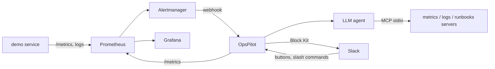

# OpsPilot

OpsPilot is an incident-triage Slack bot for on-call engineers. When Alertmanager fires, an LLM agent
gathers evidence through three MCP servers (Prometheus metrics, structured logs, markdown runbooks) and
posts a concise Slack message: what is happening, the likely cause backed by real numbers and log lines,
a runbook link, and Acknowledge / Resolve buttons. It also answers `/ask` questions with the same tools,
stores every incident in SQLite, and exports its own incident metrics (MTTA, MTTR, alert noise, LLM
latency and tokens) to a provisioned Grafana dashboard.

<!-- screenshots: docs/screenshots/slack-incident.png, grafana-dashboard.png, slash-command.png -->



More detail in [docs/architecture.md](docs/architecture.md).

## Features

- Alertmanager webhook -> agent triage -> Slack Block Kit message (summary, likely cause, evidence, runbook, severity, Ack/Resolve).
- 3 stdio MCP servers, 5 tools: `prom_query`, `prom_query_range`, `search_logs`, `search_runbooks`, `get_runbook`.
- Agent guardrails: max tool calls, overall timeout, tool errors fed back to the model, and evidence
  numbers checked against tool output (anything unverifiable is labelled `unverified`).
- Repeat alerts for an open incident are deduplicated: one message, an alert counter.
- Slash commands: `/opsstatus`, `/incident list`, `/incident summary <id>`, `/ask <question>`.
- LLM providers: Anthropic Claude (default), Ollama (free, local), `mock` (deterministic, used in tests/CI).
- Runs without Slack tokens in dry-run mode (messages are logged), so you can try everything first.
- Grafana dashboard (provisioned): incident volume, MTTA/MTTR, alert noise per service, demo service
  error rate and latency, LLM latency and tokens, MCP tool calls.

## Quickstart (5 minutes, no secrets needed)

Requirements: Docker with Compose v2, Python 3.11+ (only for `make demo` and tests).

```bash
git clone <your-fork> opspilot && cd opspilot
make up            # builds and starts demo service, load generator, Prometheus, Alertmanager, Grafana, OpsPilot
make demo          # turns on chaos, waits for the alert, prints what OpsPilot produced
```

Then open:

- Grafana: <http://localhost:3000/d/opspilot> (anonymous access, dashboard is provisioned)
- Prometheus alerts: <http://localhost:9090/alerts>, Alertmanager: <http://localhost:9093>
- Incidents as JSON: <http://localhost:8000/incidents>

Without Slack tokens OpsPilot runs in **dry-run mode**; see the posted message with
`docker compose logs opspilot | grep "DRY-RUN slack post"`. Try the slash commands and buttons without Slack:

```bash
curl -X POST localhost:8000/dev/command/opsstatus
curl -X POST localhost:8000/dev/command/incident -d "list"
curl -X POST localhost:8000/dev/command/ask -d "why is checkout slow?"
curl -X POST "localhost:8000/incidents/1/ack?user=me"       # MTTA updates on the dashboard
curl -X POST "localhost:8000/incidents/1/resolve?user=me"   # MTTR updates
make demo-reset    # chaos off;   make down   # stop and delete volumes
```

With the default `LLM_PROVIDER=mock` the "agent" is a deterministic stub that still calls the real MCP
tools against the real stack. For real analysis set `LLM_PROVIDER=anthropic` and `ANTHROPIC_API_KEY`
in `.env`, or `LLM_PROVIDER=ollama` (run Ollama on the host; use `OLLAMA_URL=http://host.docker.internal:11434`
from the container and a tool-capable model such as `llama3.1`).

### Connect Slack

Follow [docs/slack-setup.md](docs/slack-setup.md): create the app from the pasted manifest (Socket Mode,
scopes, slash commands, interactivity), put the two tokens in `.env`, `make up`.

## Development

```bash
python -m venv .venv && . .venv/bin/activate     # Windows: .venv\Scripts\activate
pip install -e ".[dev]"
make test      # LLM_PROVIDER=mock, no network or secrets needed
make lint      # ruff check + ruff format --check
python scripts/gen_dashboard.py   # regenerate the Grafana dashboard JSON
```

CI (`.github/workflows/ci.yml`) runs lint and tests on every push.

## Configuration

All via environment variables / `.env` (see `.env.example`).

| Variable | Default | Meaning |
|---|---|---|
| `LLM_PROVIDER` | `mock` | `anthropic`, `ollama` or `mock` |
| `LLM_MODEL` | provider default | Anthropic default `claude-opus-5-5`, Ollama default `llama3.1` |
| `ANTHROPIC_API_KEY` | empty | required for `anthropic` |
| `OLLAMA_URL` | `http://localhost:11434` | Ollama endpoint |
| `SLACK_BOT_TOKEN`, `SLACK_APP_TOKEN` | empty | both set = live Slack; otherwise dry-run |
| `SLACK_CHANNEL` | `#incidents` | where incidents are posted |
| `PROMETHEUS_URL` | `http://localhost:9090` | metrics MCP server and `/opsstatus` |
| `LOG_FILE` | `data/demo_service.log` | JSON log file the logs MCP server reads |
| `RUNBOOKS_DIR` | `runbooks` | runbook folder |
| `RUNBOOK_BASE_URL` | placeholder GitHub URL | prefix for runbook links; set to your repo |
| `DATABASE_URL` | `sqlite:///data/opspilot.db` | incident store |
| `AGENT_MAX_TOOL_CALLS` | `8` | tool-call budget per question/triage |
| `AGENT_TIMEOUT_S` | `60` | wall-clock limit per question/triage |

Alert rules (error rate > 5%, p95 > 500ms, scrape down; each for 30s) live in `deploy/alert_rules.yml`.

## Design decisions and trade-offs

- **MCP over hard-coded tools.** Each data source is a small stdio MCP server, so tools are discoverable by
  the agent and reusable from any MCP client. Cost: three extra subprocesses and a bit of startup time.
- **Socket Mode.** No public URL or ngrok; works behind NAT. Less suited to large multi-workspace distribution.
- **Webhook returns 202 immediately**; triage runs in the background so Alertmanager never times out.
- **Dedupe key is `(alertname, service)` on unresolved incidents**, not the Alertmanager fingerprint:
  a flapping alert reuses the open incident until a human resolves it. Alertmanager `send_resolved` is off
  on purpose, so MTTR measures human resolution.
- **Incident gauges are computed from SQLite at scrape time**, so MTTA/MTTR survive restarts; Prometheus
  counters (alerts, incidents created, LLM tokens) cover rates.
- **Anti-hallucination is layered, not absolute.** The prompt requires quoting tool output, and evidence
  numbers are mechanically checked against tool output. It catches invented numbers, not wrong reasoning.
- **A failed or slow agent never blocks an incident**: the message is posted with a plain summary.
- **Provider-neutral message format** with a `raw` passthrough, so Claude thinking blocks are replayed unchanged.
- **Mock provider** is deterministic and exercises the real tool path, which keeps CI offline and fast.

## Limitations

- Verified live in this repo: the full alert -> MCP tools -> incident pipeline, dedupe, Ack/Resolve over HTTP,
  slash-command logic, `/metrics` and the Grafana dashboard, all with the mock LLM and Slack dry-run.
  **Not verified end to end by the author:** posting to a real Slack workspace (buttons and slash commands run
  through the same code, tested with a mocked Slack client), the Anthropic provider (message conversion
  unit-tested, no live call) and the Ollama provider (tested against a mocked HTTP transport).
- Logs MCP server reads a local file (last 4 MB); production would query Loki/Elasticsearch.
- Runbook search is keyword overlap, not embeddings.
- Single OpsPilot instance (SQLite, in-process dedupe); no auth on the HTTP endpoints (`/dev/command`
  is disabled when Slack is live, but `/incidents/*` is open: put it behind a network boundary).
- Services are discovered from Prometheus `up`; one demo service (`checkout`) has error/latency data.
- `/status` is reserved by Slack, so the command is `/opsstatus`.

## Future work

- Alertmanager `resolved` notifications and auto-resolve; escalation / on-call paging.
- Retrieval over past incidents and postmortems; embedding-based runbook search.
- Loki/Tempo MCP servers; per-service dashboards; Slack thread replies for agent follow-ups.
- Request signing/auth on the HTTP API; Postgres for multi-replica deployments.

## Repository layout

```
app/            OpsPilot: webhook, agent, LLM providers, Slack, SQLite store, metrics
mcp_servers/    metrics_server.py, logs_server.py, runbooks_server.py
demo_service/   checkout service with /metrics, /chaos and JSON logs, plus load generator
runbooks/       markdown runbooks (error rate, latency, down, OOM, DB connections, disk)
deploy/         Prometheus, alert rules, Alertmanager, Grafana provisioning + dashboard
scripts/        demo.py, gen_dashboard.py
tests/          unit + integration tests (mock LLM, mocked Slack client)
docs/           architecture.md, slack-setup.md, screenshots/
```
