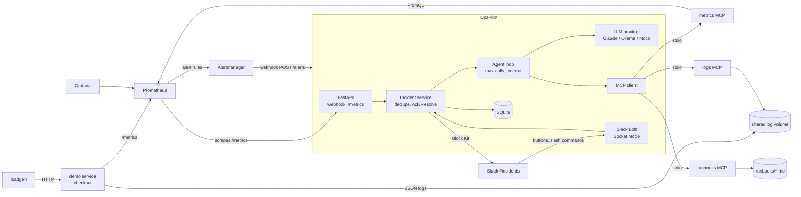

# Architecture

## Alert to Slack message

1. Prometheus evaluates `deploy/alert_rules.yml` every 5s. A rule must hold for 30s before it fires.
2. Alertmanager groups by `alertname, service`, waits 10s (`group_wait`), then POSTs to `opspilot:8000/alerts`.
3. The webhook returns `202` immediately; processing continues in a background task.
4. For each firing alert the incident service looks for an unresolved incident with the same
   `(alertname, service)`. Found: bump `alert_count` and refresh the existing Slack message.
   Not found: create the incident row first (so concurrent repeats dedupe), then run triage.
5. The agent asks the LLM, which calls MCP tools (`prom_query`, `search_logs`, `search_runbooks`, ...).
   Tool output is fed back until the model answers with a JSON triage. Limits: `AGENT_MAX_TOOL_CALLS`
   (default 8; after that tools are withdrawn so the model must answer) and `AGENT_TIMEOUT_S` (60).
6. Numbers in the evidence are checked against the tool output; anything not found is labelled
   `unverified`. If the agent fails or times out, the incident is still posted with a plain summary.
7. The Block Kit message is posted; its channel and `ts` are stored so Ack/Resolve can edit it later.

## Components

| Component | Where | Notes |
|---|---|---|
| Demo service | `demo_service/` | `/checkout`, `/chaos`, `/metrics`, JSON log file |
| MCP servers | `mcp_servers/` | stdio, FastMCP; logic in plain functions so it is unit-testable |
| MCP client | `app/mcp_client.py` | spawns the 3 servers, maps tool names to sessions |
| LLM providers | `app/llm/` | `anthropic`, `ollama`, `mock`; provider-neutral message format |
| Agent | `app/agent.py` | loop, budget, timeout, number verification |
| Incident service | `app/incidents.py` | dedupe, ack/resolve, slash-command logic |
| Slack | `app/slack_bot.py`, `app/slack_blocks.py`, `app/notifier.py` | Bolt + Socket Mode, dry-run without tokens |
| Store | `app/db.py` | SQLAlchemy + SQLite; MTTA/MTTR computed at scrape time |
